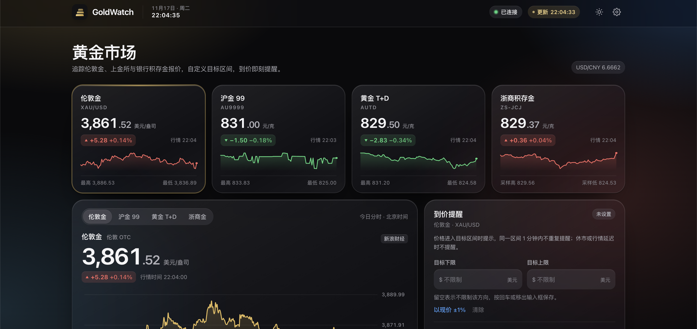

# GoldWatch

实时监测伦敦金、上海黄金交易所金价与银行积存金的网页工具。支持为每个品种设置目标价格区间，价格进入区间时通过页内提示、提示音、系统通知和提醒记录告知。

界面遵循 Apple 设计语言：SF 系统字体、玻璃质感面板、分段控件、底部/居中弹出面板，内置浅色与深色外观，并支持「红涨绿跌 / 绿涨红跌」两种配色习惯。



## 功能

- **四类行情**：伦敦金 XAU/USD、上金所 Au99.99、黄金 T+D、浙商银行积存金，5 秒推送一次。
- **交易时段识别**：区分交易中、午间休市、结算暂停、系统清算、已收盘与休市；休市时卡片和图表明确标注，并显示最后成交价。
- **分时走势**：当日分时图，含昨收参考线、目标区间色带、悬停十字线读数。东方财富未提供积存金分时，该品种由服务端与页面共同累积采样点，并给出采样开高低与均值。
- **到价提醒**：每个品种独立设置下限/上限，留空表示不限方向；价格从区间外进入区间时触发，同一区间 1 分钟内不重复提醒。仅在交易时段且行情有效时提醒，休市或行情延迟不会误报；修改区间后可点击「开始监控」清除上一周期状态，并立即按现价重新判断。
- **多渠道提示**：页内通知始终开启；提示音与系统通知可在设置中开关（系统通知需浏览器授权，页面切到后台时推送）。
- **提醒记录**：最近 20 条保存在浏览器本地，不上传服务器；同品种、同区间的连续提醒自动合并计数，点击记录可切换到对应品种走势。
- **细节**：断线自动重连、数据延迟标记、参考换算价标注、北京时间基准、移动端横滑行情卡片、无障碍焦点与 `prefers-reduced-motion` 支持。

## 快速开始

要求 Node.js ≥ 20.11。

```bash
npm install
npm run dev
```

- 前端（Vite）：<http://localhost:5173>
- 行情代理（Express）：<http://localhost:8787>，开发时由 Vite 代理 `/api`

生产构建与运行：

```bash
npm run build
npm start
```

构建后由 Express 同时提供静态页面与 API，默认访问 <http://localhost:8787>。

### 环境变量

| 变量 | 默认值 | 说明 |
| --- | --- | --- |
| `PORT` | `8787` | HTTP 服务端口 |
| `POLL_INTERVAL_MS` | `5000` | 服务端拉取行情间隔，限制在 2–60 秒 |

示例：`PORT=9000 POLL_INTERVAL_MS=10000 npm start`

## 数据来源与降级

服务端作为统一代理，避免浏览器跨域、Referer 限制与频繁请求：

1. **主源：新浪财经**（`hq.sinajs.cn`），同时提供三个交易所品种与 USD/CNY。
2. **补位：东方财富**（`push2.eastmoney.com`），用于缺失报价及当日分时走势（`push2his.eastmoney.com`）。
3. **积存金：京东金融**（`api.jdjygold.com`），提供浙商银行积存金最新价与昨收；支付宝内的同类产品价格与之一致。
4. **兜底：gold-api.com**（伦敦金现价）与 open.er-api.com（USD/CNY）。
5. 若上金所报价缺失但伦敦金与汇率可用，会按 `XAU × USD/CNY ÷ 31.1034768` 生成**参考换算价**，并在卡片上以「参考换算」标注，不冒充交易所报价。

任一数据源成功即维持服务；整轮失败时保留上一次快照并标记延迟，前端展示重连横幅。所有时间统一按北京时间（UTC+8）解析与展示。

### 交易时段

| 品种 | 时段（北京时间） |
| --- | --- |
| 上金所 Au99.99 / 黄金 T+D | 09:00–11:30、13:30–15:30、20:00–次日 02:30；周五无夜盘，周末休市 |
| 浙商银行积存金 | 工作日 24 小时交易，每日 23:50–00:10 系统清算；周末休市，周一 00:10 开盘 |
| 伦敦金 XAU/USD | 周一开盘至周六凌晨，每日约 1 小时结算暂停（按纽约时段自动适配夏令时） |

上金所 15:30 日盘收盘后，报价会停留在 15:29:59 的最后一笔成交价，直到 20:00 夜盘开始；这是正常休市，不是断线。界面会在卡片、图表和提醒面板标注「已收盘 / 午间休市 / 结算暂停 / 休市」。

交易时段内若报价超过 2 分钟没有更新，才会标记为「延迟」。法定节假日的临时休市以交易所公告为准，此时行情通常也会停止更新并显示延迟。

## 架构

```
浏览器 ── SSE /api/stream（5s 推送，失败时 10s 轮询兜底）
   │        └─ /api/quotes、/api/history、/api/health
   ▼
Express 行情代理（内存快照 + 30s 分时缓存 + 限流 + 安全响应头）
   ▼
新浪财经 → 东方财富 / 京东金融 → gold-api.com / open.er-api.com
```

> 部署到云端时，Express 层由 `worker/` 的 Cloudflare Worker 承担（内存快照 + 4s TTL，SSE 换成前端轮询），前端走 GitHub Pages 静态托管，详见下文「部署」。

- `shared/`：前后端共享的品种元数据与类型。
- `server/`：Express 服务、数据源适配器、行情聚合与降级逻辑。
- `src/`：React 界面、SSE 数据层、提醒引擎、自绘 SVG 分时图与样式令牌。
- 提醒判定与时间/区间解析为纯函数，单测覆盖边界、冷却与行情解析。

### API

| 方法 | 路径 | 说明 |
| --- | --- | --- |
| GET | `/api/quotes` | 当前快照（含各品种 `sessions` 交易状态；未就绪时 503） |
| GET | `/api/history?id=xauusd\|au9999\|autd\|zsjcg` | 当日分时序列 |
| GET | `/api/stream` | SSE，事件名 `quotes`，15 秒心跳 |
| GET | `/api/health` | 运行状态、数据源计数、SSE 客户端数 |

服务端限制：每 IP 每分钟 180 次请求、最多 80 个 SSE 连接、上游请求 8 秒超时。浏览器端使用严格的 CSP、`X-Frame-Options: DENY`、`nosniff` 等安全响应头。

## 部署（PWA + 无服务器）

手机使用的推荐路径：前端静态托管在 GitHub Pages，行情 API 部署为 Cloudflare Worker 并绑定自定义域名（`*.workers.dev` 默认域名在国内被 DNS 污染，不可直接用），手机浏览器「添加到主屏幕」后全屏运行（PWA）。

快速流程（详细步骤见 [docs/DEPLOY.md](docs/DEPLOY.md)，踩坑记录见 [docs/DEPLOY-NOTES.md](docs/DEPLOY-NOTES.md)）：

```bash
npm run deploy:api   # 1. 部署 Worker（wrangler，首次需 npx wrangler login）
npm run deploy:web   # 2. 构建并推送 gh-pages 分支（需 .env.production 里配置 VITE_API_BASE）
```

然后在仓库 Settings → Pages 选择 `gh-pages` 分支。

### 本地模式不变

`npm run dev` / `npm start` 仍是 Express 本地服务，行为与改造前一致（SSE + Vite 代理）。

## 测试

```bash
npm test        # 单元测试（提醒边界/冷却、记录合并、分时合并、行情解析）
npm run typecheck
npm run build
```

## 目录

```
docs/              项目截图、部署 SOP（DEPLOY.md）与踩坑记录（DEPLOY-NOTES.md）
public/            PWA 清单、Service Worker、应用图标
worker/            Cloudflare Worker 无服务器行情 API
server/            Express API、行情源与聚合
shared/            品种与数据类型
src/components/    界面组件（卡片、图表、面板、设置）
src/hooks/         行情订阅与尺寸/数字动画
src/lib/           提醒、格式化、存储、声音、通知
src/styles/        设计令牌与页面样式
```

## 免责声明

行情数据来自第三方公开接口，可能存在延迟、缺失或错误，仅用于个人参考，不构成任何投资建议。请勿将本工具用于交易决策或自动化下单。
